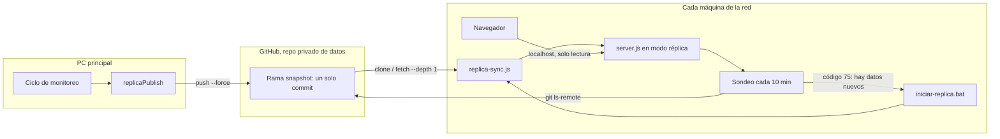

# Réplicas de solo lectura

Copias locales de la app para que varias personas de una red que no permite
túneles ni servidores puedan consultar los datos del monitoreo. Cada copia
corre en la máquina de quien la usa, se trae los datos de un repo privado de
GitHub y no puede cambiar nada.

- Instalación y configuración paso a paso: [instalacion.md](instalacion.md)
- Diseño y requisitos formales: `openspec/changes/replicas-solo-lectura/`

## Cómo funciona

1. **La PC principal publica.** Al cerrar cada ciclo de monitoreo (el
   automático y "Actualizar ahora"), si `REPLICA_PUBLISH_DIR` está
   configurado, la app arma el *snapshot* en esa carpeta y lo sube a GitHub.
2. **GitHub guarda solo la foto actual.** El snapshot es un único commit en la
   rama `snapshot`, reescrito en cada publicación (`commit --amend` y
   `push --force`). No se acumula historia en la rama.
3. **Cada réplica se actualiza sola.** Cada 10 minutos compara el commit de
   GitHub con el que tiene. Si cambió, la app se cierra con el código 75, el
   lanzador baja el snapshot nuevo, lo aplica y la vuelve a levantar. Quien
   la usa ve la app unos segundos sin responder y después los datos nuevos.

## Qué viaja en el snapshot

| Archivo | Qué es |
|---|---|
| `monitoring.db.gz` | Copia comprimida de la base, solo con lo que muestran las pantallas: posteos, medianas de cada cuenta y reclamos |
| `config/monitoring.json` | Cuentas, keywords y búsquedas configuradas |
| `media/` | Fotos de los posteos (miniatura y grande), en espejo de `data/media/` |
| `snapshot.json` | Fecha de publicación, número de ciclo y versión del código |

No viajan el `.env`, las claves de Apify ni del LLM, la lista de emails
habilitados ni ningún dato del login. La base se copia con `VACUUM INTO`
desde una conexión de solo lectura, así que la copia es consistente aunque el
monitoreo esté escribiendo.

El resto de las tablas viaja vacío: el registro de llamadas a Apify, las
corridas, los posteos ya vistos, el caché de direcciones, el historial de
seguidores y los links de login. La lista es de lo que entra, no de lo que
sale: una tabla nueva viaja vacía hasta que se la sume a propósito en
`PUBLISHED_TABLES` (`src/replicaPublish.js`). Después la base se comprime
con gzip. Como git no puede guardar diferencias de un archivo comprimido,
cada snapshot sube la base entera. No suma peso en GitHub, porque la rama
tiene un solo commit que se reemplaza cada vez.

## Qué puede y qué no puede hacer una réplica

Puede ver todo lo que se lee: Monitoreo en vivo (tabla, feed y pop-up), "Se
despegaron" y el mapa de reclamos. El gasto en Apify no se ve en una copia:
ninguna pantalla lo muestra y su registro no viaja.

No puede escribir ni gastar:

- No corre el monitoreo ni llama a Apify o al LLM: no tiene las claves.
- No tiene "Análisis de publicación", "Actualizar ahora", ignorar posteos,
  cambiar sentimientos, agregar cuentas, keywords o búsquedas, ni cambiar el
  estado de los reclamos.
- No tiene login: se entra directo, pero solo desde la misma máquina.

Lo único que sí puede hacer es cuidarse a sí misma:

- **Buscar datos nuevos** (botón de la franja): si la PC principal publicó
  algo que la copia no tiene, la app se reinicia, baja el snapshot y la
  página se recarga sola. Si ya está al día, lo dice.
- **Cargar el token de lectura** (modal): aparece la primera vez que se abre
  la copia, mientras no haya token, y otra vez si el repo deja de aceptar el
  guardado (venció o lo revocaron). La copia se entera al arrancar, en cada
  sondeo y con "Buscar datos nuevos": un error de git que no es de red
  cuenta como token rechazado (`src/replicaPoller.js`). El token se prueba
  contra el repo de datos antes de guardarlo en el `.env` local; si no
  sirve, el modal dice por qué (sin acceso, vencido, sin conexión).

En la copia, git corre sin las credenciales guardadas en la máquina
(`credential.helper` vacío y `GCM_INTERACTIVE=never`). Si no fuera así, con
un token rechazado Git para Windows abriría la ventana de login de Git
Credential Manager y git quedaría colgado esperándola.

La barrera real está en el servidor (`src/replicaGuard.js`):

- Todo pedido que no sea GET o HEAD recibe **403** "Esta copia es de solo
  lectura.". La regla va por método y no por ruta, así que una ruta nueva que
  escriba queda cubierta sola. Las únicas excepciones son
  `POST /api/replica/refresh` y `POST /api/replica/token` (las dos de arriba),
  y solo si el pedido viene de la propia página de la app (`Origin`
  `http://localhost:<puerto>`): una página web cualquiera abierta en el mismo
  navegador no puede dispararlas.
- La app escucha solo en `127.0.0.1`, y un `Host` que no sea `localhost` con
  el puerto recibe **421**. Eso impide que otra máquina de la red, o una
  página web maliciosa, lea los datos.

El frontend, además, esconde o deshabilita los controles que escriben y
muestra arriba una franja: "Copia de solo lectura · Datos al DD/MM HH:MM".
Si el snapshot vino de una versión del código distinta a la instalada,
agrega "Hay una versión nueva de la app: pedí el instalador actualizado".

## Seguridad

- **Token de escritura** (solo en la PC principal): lo usa git para subir el
  snapshot. Queda en el administrador de credenciales de Windows, no en el
  repo de la app ni en el `.env`.
- **Token de lectura** (en cada réplica): se pega en el modal y queda solo en
  el `.env` local de cada máquina (`%LOCALAPPDATA%\SocialListening\.env`);
  nunca vuelve al navegador ni se escribe en un log. Se le pasa a git por
  variables de entorno (`http.extraHeader`), nunca en la URL, y se borra de
  cualquier mensaje de error antes de loguearlo.
- Quien tenga el token de lectura puede bajar la base completa del monitoreo.
  Si se filtra, se revoca en GitHub y se carga uno nuevo en cada máquina (ver
  [instalacion.md](instalacion.md#42-cambiar-el-token-de-una-réplica)).

## Variables de entorno

| Variable | Dónde | Default | Para qué |
|---|---|---|---|
| `APP_MODE` | las dos | `principal` | `replica` activa el modo de solo lectura. Otro valor aborta el arranque |
| `REPLICA_PUBLISH_DIR` | principal | vacío | Carpeta con el clon del repo de datos. Vacío: no publica |
| `REPLICA_REPO_URL` | réplica | — | URL https del repo de datos |
| `REPLICA_DATA_DIR` | réplica | `<app>\replica-datos` | Dónde queda el clon del snapshot |
| `REPLICA_POLL_MINUTES` | réplica | `10` | Cada cuánto busca datos nuevos (mínimo 1) |
| `DATA_REPO_TOKEN` | réplica | — | Token de solo lectura del repo de datos |
| `REPLICA_GIT` | réplica | `git` | Ejecutable de git; el lanzador apunta al MinGit portable |
| `PORT` | las dos | `3000` | Puerto de la app |

## Archivos

| Archivo | Qué hace |
|---|---|
| `src/appMode.js` | Lee y valida `APP_MODE` |
| `src/replicaPublish.js` | PC principal: arma el snapshot y lo sube |
| `src/replicaGit.js` | Corre git con el token por entorno y limpia los errores |
| `src/replicaFiles.js` | Copias atómicas y espejo de carpetas |
| `src/replicaGuard.js` | Réplica: solo lectura, solo localhost, sin login |
| `src/replicaSync.js`, `scripts/replica-sync.js` | Réplica: trae el snapshot y lo aplica |
| `src/replicaPoller.js` | Réplica: detecta datos nuevos y sale con 75 |
| `src/replicaRoutes.js` | `GET /api/app/mode`, `POST /api/replica/refresh` y `POST /api/replica/token` |
| `src/replicaToken.js` | Prueba el token contra el repo de datos y lo guarda en el `.env` |
| `src/appVersion.js` | Versión del código (`build-info.json` o git) |
| `installer/armar-instalador.ps1` | Arma el zip para repartir |
| `installer/instalar.ps1` | Instala o actualiza una réplica |
| `installer/iniciar-replica.bat` | Bucle: sincronizar, arrancar, reiniciar |
| `installer/LEEME.txt` | Instrucciones cortas que van dentro del zip |

## Cómo se aplica un snapshot

`scripts/replica-sync.js` corre con la app apagada, antes de cada arranque:

1. Sin clon local: `git clone --depth 1 --branch snapshot`. Con clon:
   `git fetch --depth 1` y `git reset --hard` a lo que llegó.
2. Copia la base a `data\monitoring.db.nuevo` y la revisa con
   `PRAGMA integrity_check`. Si está dañada, la descarta y deja la anterior.
3. Borra el `-wal` y el `-shm` viejos y renombra la nueva sobre
   `data\monitoring.db`.
4. Espeja las fotos (copia las nuevas, borra las que ya no están), copia la
   config y guarda `snapshot.json` como `data\replica-snapshot.json`.

Si no hay red, sigue con lo último que tenía. Si nunca bajó nada, la app
arranca vacía y lo dice en la franja.

## Límites conocidos

- **Tamaño.** GitHub rechaza archivos de más de 100 MB: si `monitoring.db`
  pasa ese tamaño, la publicación falla (queda en el log de la PC principal).
  Además, cada publicación sube la base entera. Las fotos, en cambio, se
  suben solo cuando son nuevas.
- **Demora.** Los datos llegan a las réplicas entre unos segundos y
  `REPLICA_POLL_MINUTES` después de que termina el ciclo.
- **Librerías de internet.** El frontend carga Tabulator y Leaflet de una CDN
  y el mapa base de internet. Si la red las bloquea, la tabla o el mapa no se
  ven.
- **Sin escritura.** Que las réplicas puedan escribir (por ejemplo, marcar
  sentimientos) es otra etapa: eventos por usuario que la PC principal
  aplica. No está hecho.
- **Actualizar el código.** La réplica no se actualiza sola: avisa y hay que
  instalar el zip nuevo.
