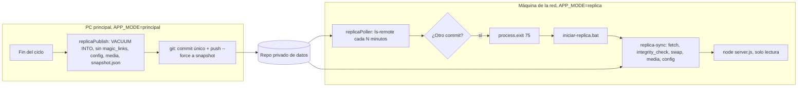

# Design: replicas-solo-lectura

## Technical Approach

Un solo lugar escribe los datos (la PC principal) y muchos los leen. La
principal publica al final de cada ciclo una foto completa de lo que la UI
necesita; las réplicas la traen y la sirven tal cual, con el mismo
`server.js` y el mismo frontend, en un modo que no escribe nada.



## Architecture Decisions

- **`APP_MODE` (`principal` | `replica`, default `principal`).**
  `src/appMode.js`, calcado de `src/refreshMode.js`: un valor desconocido
  aborta el arranque. Vacío es `principal`, así una instalación existente
  no cambia nada.

- **Snapshot como un commit único en la rama `snapshot`, con force-push.**
  GitHub guarda solo la foto actual (el repo no crece con cada ciclo). Las
  fotos de los posteos no cambian una vez guardadas: mismo contenido, mismo
  blob, así que git las sube y las baja una sola vez. Un mecanismo para la
  base y para las fotos, sin armar comprimidos propios. Alternativas
  descartadas: Releases de GitHub (un asset por foto o un comprimido entero
  por ciclo) y la base en el historial (crece ~1,5 MB por ciclo).
  Commit único: si `HEAD` existe, `commit --amend`; si no, el primer
  commit. Siempre con `-c user.name` / `-c user.email` propios, así no
  depende de la identidad configurada en la máquina.

- **La base se copia con `VACUUM INTO`, desde una conexión propia en solo
  lectura.** La base está en WAL: copiar el archivo en caliente puede dejar
  una copia inconsistente. `VACUUM INTO` escribe una copia consistente y
  compacta, y funciona sobre una conexión `readOnly`, así que la
  publicación no comparte la conexión de `src/db.js` ni la bloquea. Sobre
  la copia se vacían todas las tablas salvo `detected_posts`,
  `account_stats` y `reclamos` (lo único que leen las pantallas de la
  réplica), después `VACUUM` y gzip a `monitoring.db.gz`. Es una lista de
  lo que entra, no de lo que sale: `magic_links` (lo único con datos del
  login; las sesiones viven en cookies firmadas) queda afuera, y una tabla
  nueva también, hasta sumarla a propósito. Lo que se vacía solo lo usa la
  principal para trabajar: `apify_calls` y `monitoring_runs` (la ruta de
  costos existe pero ninguna pantalla la pide), `search_seen`,
  `refresh_state`, `geocode_cache`, `account_followers` (los seguidores que
  se muestran están en `detected_posts`) y `x_influencers` (se vuelve a
  sembrar del CSV al arrancar). `src/db.js` exporta `DB_PATH` para que la
  publicación lea la misma base que la app (incluido `MONITORING_DB_PATH`
  en tests).

- **Base comprimida.** gzip achica una base SQLite de texto varias veces y
  la réplica la descomprime antes del `integrity_check`. El costo: git no
  puede guardar diferencias de un `.gz`, cada snapshot sube el archivo
  entero; da igual porque la rama es un único commit con force-push (no
  hay historia que crezca) y la réplica baja con `--depth 1`. La réplica
  acepta también `monitoring.db` sin comprimir, para seguir andando si se
  actualiza antes que la principal.

- **Contenido del snapshot.**

  ```
  monitoring.db
  snapshot.json            { publishedAt, runId, appVersion }
  config/monitoring.json
  media/<plataforma>/<id>_thumb.jpg, <id>_full.jpg
  ```

  Ni `config/monitoring-x.json` (lo absorbió `monitoring.json`, queda solo
  como legado) ni `account-types.json` (lo usa únicamente el análisis de
  publicación, que la réplica no tiene).

  Fotos en espejo: se copian las que faltan o cambiaron de tamaño y se
  borran las que ya no están.

- **La publicación nunca frena el ciclo.** `runCycleUnlocked` la llama en
  su `finally`, después de `reconcileRealCosts`; cualquier error termina en
  `[réplica] no se pudo publicar: ...` y el ciclo siguiente lo reintenta.
  Sin `REPLICA_PUBLISH_DIR` no hace nada; en modo réplica nunca corre (no
  hay scheduler). La carpeta es un clon del repo de datos que el dueño hace
  una vez (`git clone <url> <carpeta>`), fuera del repo de código.

- **El token nunca en argumentos ni URL.** `src/replicaGit.js` pasa la
  autenticación por variables de entorno del proceso hijo:
  `GIT_CONFIG_COUNT=1`, `GIT_CONFIG_KEY_0=http.extraHeader`,
  `GIT_CONFIG_VALUE_0=Authorization: Basic base64(x-access-token:<token>)`,
  más `GIT_TERMINAL_PROMPT=0` (que nunca se quede esperando una
  contraseña). Los mensajes de error de git se pasan por un filtro que
  reemplaza el token y su base64 si aparecieran. En la principal no hay
  token: usa el git ya autenticado de la máquina.

- **La réplica se reinicia en vez de reabrir la base.** `src/db.js` abre la
  base al cargarse y la comparten muchos módulos: reabrirla en caliente
  tocaría todos. En cambio, `replicaPoller` compara cada
  `REPLICA_POLL_MINUTES` (default 10) el commit remoto de `snapshot`
  (`git ls-remote`, sin bajar nada) con el `HEAD` local; si difieren, el
  server sale con el código 75 y el lanzador corre la sincronización y lo
  vuelve a levantar. Si la consulta falla, se loguea y se reintenta en la
  vuelta siguiente; nunca sale por un error.

- **Sincronización fuera del server.** `scripts/replica-sync.js`
  (`src/replicaSync.js`) corre antes de cada arranque y no carga
  `src/db.js`. Sin clon: `git clone --depth 1 --branch snapshot`. Con clon:
  `git fetch --depth 1 origin snapshot` + `git reset --hard FETCH_HEAD`.
  Aplicar: copiar la base a `monitoring.db.nuevo`, `PRAGMA integrity_check`
  en solo lectura, borrar `-wal` y `-shm` viejos, renombrar sobre
  `monitoring.db`; espejo de `media/`; config a `config/`; `snapshot.json` a
  `data/replica-snapshot.json`. Si git falla (sin red), aplica lo que ya
  tiene el clon y lo dice; si nunca hubo clon, arranca con lo que haya.

- **Modo réplica en `server.js`.**
  - `checkEnv` no corre: la réplica no tiene claves de Apify, LLM, SMTP ni
    `SESSION_SECRET`.
  - Sin `startScheduler()` ni `startKeepAwake()`.
  - `app.listen(PORT, '127.0.0.1')`.
  - En vez de `createAuthGate()`, `createReplicaGuard({ getPort })`.

- **`replicaGuard`.** En este orden:
  1. `Host` distinto de `localhost:<port>`, `127.0.0.1:<port>` o
     `[::1]:<port>` → 421. Corta el DNS rebinding: una página de afuera
     que resuelva su dominio a 127.0.0.1 para leer los datos.
  2. Método distinto de GET/HEAD → 403 "Esta copia es de solo lectura".
     Por método y no por ruta: cubre todo lo que escribe o gasta (análisis,
     "Actualizar ahora", backfill, ignorar, sentimiento, cuentas, keywords,
     búsquedas, reclamos, login) y cualquier ruta que se agregue.
  3. `req.auth = { email: 'copia.local' }` para las rutas que lo leen.
  4. `/`, `/index.html` y `/login-verify.html` redirigen a
     `/dashboard.html`: no hay login.

- **`GET /api/app/mode`** (`src/replicaRoutes.js`). En principal:
  `{ mode: 'principal', readOnly: false }` (detrás del login como todo
  `/api`). En réplica: `{ mode: 'replica', readOnly: true, dataAsOf,
  runId, appVersion, snapshotAppVersion, newerAppAvailable }`, leído de
  `data/replica-snapshot.json` en cada pedido (cambia con cada reinicio).
  `newerAppAvailable` solo si las dos versiones existen y difieren.

- **Versión de la app** (`src/appVersion.js`): `build-info.json` en la raíz
  (lo escribe el armado del instalador con el commit) y, si no está,
  `git rev-parse --short HEAD`. null si no hay ninguna de las dos: sin
  versión no se avisa nada.

- **Frontend.** `main.js` (lo cargan todas las páginas de la app) consulta
  `/api/app/mode`. En réplica marca `<html data-readonly>`, agrega la
  franja y, si la solapa activa es "Análisis de publicación", pasa a
  "Monitoreo en vivo". El CSS esconde bajo `[data-readonly]`: la solapa de
  análisis, los `add-row` y la ✕ de los chips, "Actualizar ahora" y el
  "Escuchando · próxima corrida", la ✕ de ignorar (tabla y feed) e
  "Ignorar" del pop-up, el selector de estado de los reclamos y "Cerrar
  sesión". Los selectores de sentimiento y de estado de los reclamos quedan
  a la vista, deshabilitados (`disabled` al dibujarlos, con el estilo
  normal). El servidor es la barrera real: lo que se
  escape del CSS recibe 403.

- **Instalador** (`installer/`). `armar-instalador.ps1` arma
  `dist/SocialListening-replica.zip`: Node portable win-x64 y MinGit
  portable (descargas oficiales, versiones como parámetro), la app sin
  `test/`, `openspec/`, `design/`, `data/` ni `.env`, `node_modules` de
  producción (`npm ci --omit=dev`, con el binario de `sharp` para
  win-x64), `build-info.json`, `.env` de réplica sin secretos,
  `iniciar-replica.bat` e `instalar.ps1`. `instalar.ps1` copia a
  `%LOCALAPPDATA%\SocialListening` (conserva `.env` y `data/` si ya
  existen), pide el token y lo escribe en el `.env` local, crea los
  accesos directos (escritorio e Inicio) y arranca. `iniciar-replica.bat`:
  bucle sincronizar → `node server.js`; con 75 reinicia enseguida, con otro
  código a los 10 s.

## Variables nuevas

| Variable | Dónde | Default |
|---|---|---|
| `APP_MODE` | las dos | `principal` |
| `REPLICA_PUBLISH_DIR` | principal | vacío (no publica) |
| `REPLICA_REPO_URL` | réplica | — |
| `REPLICA_DATA_DIR` | réplica | `<app>/replica-datos` |
| `REPLICA_POLL_MINUTES` | réplica | 10 |
| `DATA_REPO_TOKEN` | réplica | — |
| `REPLICA_GIT` | réplica | `git` (el instalador apunta a MinGit) |

## Tests

Todos con carpetas temporales y git simulado (`execFileFn` inyectado):
ninguno toca GitHub, `data/` ni `config/`.

- `appMode.test.js`: default, valores válidos, valor inválido.
- `appVersion.test.js`: `build-info.json`, git, ninguno.
- `replicaGit.test.js`: token en el entorno y no en los argumentos,
  filtro de errores, sin token no agrega nada.
- `replicaPublish.test.js`: base sin `magic_links` y con los posteos;
  config y media en espejo; `snapshot.json`; commit amend vs primero;
  force-push; fallo de git no tira; sin `REPLICA_PUBLISH_DIR` no hace nada.
- `replicaGuard.test.js`: Host ajeno, métodos de escritura (incluidos
  `run-now`, `analyze`, `ignore`, `reclamos`), GET sin login, redirección.
- `replicaSync.test.js`: clon inicial, fetch + reset, base corrupta no
  reemplaza, `-wal`/`-shm` borrados, media y config, git caído.
- `replicaPoller.test.js`: commit igual sigue, distinto sale con 75,
  error se loguea y sigue.
- `replicaRoutes.test.js`: respuesta en los dos modos, aviso de versión.

El frontend y el instalador no los cubre la suite: se prueban a mano.
